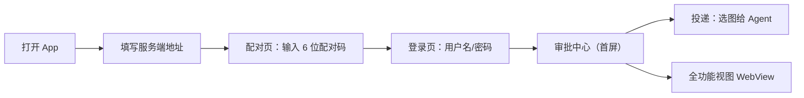

# harness_mobile Android 自用运行指南

> 面向场景：**不上架、自己用、服务端在本机 Windows、手机 Android 13+**。
> 本指南废止了所有上架相关章节（隐私清单/隐私弹窗/分渠道打包/商店材料），自用一律不需要。

---

## 0. 自用 vs 上架：砍掉了什么

| 项 | 上架需要 | 自用 | 说明 |
| --- | --- | --- | --- |
| iOS Privacy Manifest | ✅ | ❌ 不要 | 苹果审核才要（本指南不涉及 iOS） |
| 隐私合规弹窗 | ✅ | ❌ 不要 | 国内应用商店才要 |
| 分渠道打包 | ✅ | ❌ 不要 | 只装自己手机 |
| 商店截图与文案 | ✅ | ❌ 不要 | — |
| 正式签名 keystore | ✅ | ⚠️ 可选 | debug 签名即可，见 §4 |
| 账号注销端点 | ✅ | ⚠️ 降级即可 | 单用户，解绑设备够用 |
| **明文 HTTP 配置** | ❌ 应关闭 | ✅ **必须开** | 见 §2，否则连不上本机 |

**结论**：自用省掉约 4 人日发版工作，但**必须补 1 项**——Android 明文 HTTP 配置。

---

## 1. 前置检查

### 1.1 确认 Flutter 环境

```powershell
D:\Software\flutter\bin\flutter.bat doctor
```

重点看 `Android toolchain` 是否 ✅。若提示缺 Android SDK 或 JDK，需先安装。

> 本项目构建链为 **Gradle 8.9 + AGP 8.7.2 + Kotlin 1.9.24**，配 **JDK 21** 使用（无需 JDK 17）。详见 `docs/环境搭建指南.md` §2.4。

### 1.2 确认服务端监听地址（关键）

服务端监听地址决定**哪些运行环境能连上**。检查：

```powershell
# 启动服务端后，看端口监听在哪个地址
netstat -ano | Select-String ":5611"
```

**本机实测**（监听 `127.0.0.1:5611`）：

```
TCP    127.0.0.1:5611    0.0.0.0:0    LISTENING    39992
```

| 监听地址 | 模拟器（10.0.2.2） | 真机 + adb reverse | 真机 + WiFi 直连 |
| --- | --- | --- | --- |
| `127.0.0.1`（当前） | ✅ 可连 | ✅ 可连 | ❌ 连不上 |
| `0.0.0.0` | ✅ 可连 | ✅ 可连 | ✅ 可连 |

> **结论**：当前 `127.0.0.1` 监听对**模拟器和 adb reverse 都可用**，无需改动。
> 只有想用「真机 WiFi 直连」时，才需把服务端改为监听 `0.0.0.0`（检查 `config.yaml` 或启动参数）。

### 1.3 查本机局域网 IP（真机 WiFi 连接需要）

```powershell
ipconfig | Select-String "IPv4"
```

记下形如 `192.168.1.10` 的地址。

### 1.4 防火墙放行（真机 WiFi 连接常见坑）

Windows 防火墙默认可能拦截入站。首次启动服务端时若弹出提示，选择**允许专用网络**。
若已错过提示，可手动放行：

```powershell
# 以管理员运行
New-NetFirewallRule -DisplayName "harness-go 5611" -Direction Inbound -LocalPort 5611 -Protocol TCP -Action Allow
```

---

## 2. 已完成的必要配置（无需你操作，仅作说明）

### 2.1 明文 HTTP 放行

**为什么必须**：Android 9（API 28）起默认禁止明文 HTTP，而 App 的 baseUrl 归一化会为省略 scheme 的输入补 `http://`（`lib/core/config/base_url.dart:16`）。两者冲突会导致：

```
CLEARTEXT communication to 192.168.1.10 not permitted by network security policy
```

**已落盘**：`android/app/src/main/res/xml/network_security_config.xml`，并在 `AndroidManifest.xml` 的 `<application>` 上挂载 `android:networkSecurityConfig`。

当前策略：`base-config cleartextTrafficPermitted="true"`（全局允许明文，自用最省事），并额外显式放行 `localhost` / `127.0.0.1` / `10.0.2.2`。

> ⚠️ 若将来要上架，必须把 `base-config` 改为 `false`，只保留自己的地址白名单。

### 2.2 已声明的权限（Android 13+ 适配）

| 权限 | 用途 | 说明 |
| --- | --- | --- |
| `INTERNET` | 与服务端通信 | 必需 |
| `ACCESS_NETWORK_STATE` | 网络状态判断 | 必需 |
| `CAMERA` | 拍照投递 | 运行时申请 |
| `USE_BIOMETRIC` | 高风险审批二次确认 | 运行时申请 |

**注意**：**没有申请存储权限**，这是刻意的。Android 13+ 的 `image_picker` 走系统 Photo Picker（`ACTION_GET_CONTENT`），不需要 `READ_MEDIA_IMAGES`，用户体验也更好（只授权你选的那张图）。

---

## 3. 三种运行方式（按场景选）

### 方式 A：模拟器（日常开发首选）

```powershell
# 列出可用模拟器
D:\Software\flutter\bin\flutter.bat emulators

# 启动（把 <id> 换成上面列出的名字）
D:\Software\flutter\bin\flutter.bat emulators --launch <id>

# 运行（支持热重载）
cd D:\WorkSpace\Project\harness_mobile
D:\Software\flutter\bin\flutter.bat run
```

**服务端地址填**：`http://10.0.2.2:5611`

`10.0.2.2` 是 Android 模拟器访问**宿主机（你的电脑）** 的专用别名。填 `localhost` 会指向模拟器自己，连不上。

**局限**：相册只有几张内置示例图，测不了真实拍照体验。

---

### 方式 B：真机 USB 调试（测相册/相机必用）

**手机端准备**：
1. 设置 → 关于手机 → 连续点击「版本号」7 次，开启开发者选项
2. 开发者选项 → 打开「USB 调试」
3. 插 USB 线，手机上弹出「允许 USB 调试」→ 允许

**电脑端**：

```powershell
# 确认设备已识别
D:\Software\flutter\bin\adb devices
# 期望输出形如：XXXXXX    device

# 方式 B1：端口反向映射（推荐，最稳，不依赖 WiFi）
D:\Software\flutter\bin\adb reverse tcp:5611 tcp:5611
# 之后 App 里填：http://localhost:5611

# 运行
cd D:\WorkSpace\Project\harness_mobile
D:\Software\flutter\bin\flutter.bat run
```

**`adb reverse` 的优势**：手机上的 `localhost:5611` 会被转发到电脑的 `5611`，**完全绕过防火墙和 IP 变化问题**。拔线后失效，重新插线需重跑一次。

**方式 B2：WiFi 直连（不想插线时）**
App 里填 `http://<电脑局域网IP>:5611`，如 `http://192.168.1.10:5611`。
要求：手机与电脑同一 WiFi，且防火墙已放行（见 §1.4）。

---

### 方式 C：打包 APK 安装（脱离电脑日常使用）

```powershell
cd D:\WorkSpace\Project\harness_mobile
D:\Software\flutter\bin\flutter.bat build apk --release
```

产物路径：`build\app\outputs\flutter-apk\app-release.apk`

传到手机安装（需在手机上允许「安装未知来源应用」）。

**关于签名（重要）**：当前 `android/app/build.gradle:37` 是 `signingConfig = signingConfigs.debug`，即 release 包用 debug 签名。自用完全够用，但：

- ✅ 能正常安装运行
- ❌ **不要随意更换签名**，否则覆盖安装会提示「应用未安装」，必须先卸载重装
- 💡 若担心 debug 签名有效期，可生成自己的 keystore（见 §4）

---

## 4. 可选：生成自己的签名（避免签名问题）

仅在想长期稳定覆盖安装时做。生成后**务必备份**，丢失后无法覆盖升级。

```powershell
keytool -genkey -v -keystore D:\keys\harness.jks -keyalg RSA -keysize 2048 -validity 10000 -alias harness
```

然后在 `android/app/build.gradle` 里配置 release 签名（自用可把密码写在文件里，但别提交到公开仓库）。

> 若嫌麻烦，**跳过本节**——debug 签名对自用完全够，只要你不换签名就不会有覆盖安装问题。

---

## 5. 首次使用流程



1. **服务端地址**：按 §3 对应场景填写
2. **配对码**：在服务端 Web 端或桌面端生成配对码（`POST /api/v1/devices/pair-codes`），本端 `kind=mobile`
3. **登录**：输入你在服务端配置的账号
4. **审批中心**：以后打开 App 直接到这里，重启免配对免登录

---

## 6. 常见问题排查

| 现象 | 原因 | 解决 |
| --- | --- | --- |
| `CLEARTEXT communication not permitted` | 明文 HTTP 被拦 | 确认 `network_security_config.xml` 已挂载（§2.1） |
| `无法连接服务端，请确认地址与网络` | 地址错 / 服务端只监听 127.0.0.1 / 防火墙 | 见 §1.2、§1.4；优先试 `adb reverse`（§3 方式 B1） |
| 模拟器填 `localhost` 连不上 | localhost 指模拟器自己 | 改填 `10.0.2.2` |
| 真机同一 WiFi 也连不上 | Windows 防火墙 | 按 §1.4 放行 5611 |
| 配对报 `请求体格式错误` | 服务端字段校验失败 | App 已严格按契约发字段，若仍报错请查服务端日志的 `message` |
| 相册选图没反应 | Android 13+ 权限/Photo Picker | 确认系统版本 ≥13；若 ≤12 需额外适配存储权限 |
| 覆盖安装提示「应用未安装」 | 签名变了 | 先卸载旧版再装 |

---

## 7. 与「上架」的取舍差异（备查）

若将来决定上架，需要回补：

- [ ] `network_security_config.xml` 的 `base-config` 改为 `false`，仅白名单自己的地址
- [ ] 生成正式 keystore 并配置 `signingConfig`
- [ ] iOS Privacy Manifest（已落盘 `ios/Runner/PrivacyInfo.xcprivacy`，需按新增能力同步更新）
- [ ] 隐私合规弹窗（国内渠道）
- [ ] 服务端补 `DELETE /api/v1/auth/account`（苹果要求 App 内可注销账号）

---

## 8. 验收命令

```powershell
cd D:\WorkSpace\Project\harness_mobile
D:\Software\flutter\bin\flutter.bat analyze --fatal-infos --fatal-warnings   # 期望：No issues found!
D:\Software\flutter\bin\flutter.bat test                                    # 期望：151 passed
```

> PowerShell 中若用管道接 `Select-Object`，flutter 的退出码会失真（显示 1 但实际成功）。建议重定向到日志文件再读。
