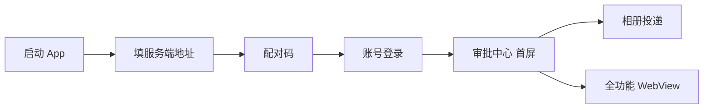

# harness_mobile 开发环境搭建指南

> 适用场景：**Windows 本机开发 + Android 自用测试（不上架）**。
> 本文所有路径与版本均来自**本机实测**（2026-11），可直接照抄；若你的安装位置不同，替换路径即可。
> 姊妹文档：`docs/Android自用运行指南.md`（运行期使用与排障）、`../harness_go/docs/移动端开发实施计划.md`（开发排期）。

---

## 0. 环境速查表（本机实测值，2026-11-10 复核）

> 🔴 **本表已于 2026-11-10 全面复核并纠正**：旧版记载的 `D:\Software\*`、`D:\WorkSpace\Project\harness_mobile`、
> `D:\Program Files\Java\jdk-21.0.8` **全部不存在**；「两套版本并存（代码基线 3.24.5 / 探针 3.47.9）」的表述也已作废。
> **现状：代码与本机 SDK 已统一到 Flutter 3.47.9**，Android 与 Windows 双端均已实测出包。

| 组件 | 本机实测版本 | 安装路径 |
| --- | --- | --- |
| Flutter SDK | **3.47.9 stable**（revision `c197ca5199`，等价于当前 stable `c197ca51`） | `D:\Software\flutter` |
| Dart | **3.13.7**（随 Flutter） | `D:\Software\flutter\bin\dart.exe` |
| JDK（Flutter/Gradle 用） | **Temurin 17.0.20.1**（`flutter config --jdk-dir` 指向此处） | `D:\Software\Java\jdk-17.0.20.1+1` |
| JDK（另有） | Temurin 21.0.8（`JAVA_HOME` 指向此处，非 Flutter 构建所用） | `D:\Software\Java\jdk-21.0.8` |
| Android SDK | **platforms 34/35/36、build-tools 33.0.1/34.0.0/36.0.0** | `D:\Software\Android\sdk` |
| platform-tools | r37.0.1 | `D:\Software\Android\sdk\platform-tools` |
| NDK | **未安装**（构建期由 Gradle 自动下载 r27 到临时目录，见 §5B） | — |
| 移动端工程 | — | `D:\WorkSpace\Project\harness_mobile` |
| Visual Studio | **VS Enterprise 2026 Insiders 18.10**（含 C++ 桌面工作负载） | `D:\Program Files\Microsoft Visual Studio\18\Insiders` |
| MSVC 工具集 | **默认 14.51 + 并存 v143（14.39.33519）** ← Windows 构建必须锁 v143，见 §5C | 同上 `VC\Tools\MSVC` |
| WebView2 Runtime | 157.0.4341.42 已装 | 系统内置 |
| NuGet CLI | **7.9.0.83**（必须写入**系统级** PATH，见 §5A） | `%USERPROFILE%\.nuget-cli\nuget.exe` |
| Windows 开发者模式 | **已开启**（否则 `flutter pub get` 报 symlink 不支持） | 设置 → 开发者选项 |

> 📌 **Flutter 已在 PATH 中**（`D:\Software\flutter\bin`），可直接用 `flutter` / `dart` / `adb`。
> 若未生效，用绝对路径 `D:\Software\flutter\bin\flutter.bat`。

> 📌 **本机物理内存实测 64GB（空闲 52GB）**：旧版「15.6G、空闲仅 2~3G、构建必然 OOM」的断言**已推翻**。
> 因此 `android/gradle.properties` 的内存参数已从极端保守值（`-Xmx1280m`/`workers.max=1`/关并行）上调。
> 但**即便内存充足**，仍需 `--target-platform android-arm64` 单架构构建，原因与内存无关，见 §5B。

---

## 1. 安装 Flutter SDK

### 1.1 获取 3.47.9

两种方式，**本机采用就地 git 切 tag**（省 1.85GB 下载、保留引擎缓存）：

```powershell
cd D:\Software\flutter
git fetch --tags
git checkout 3.47.9            # 或等价：git checkout -B stable 3.47.9
Remove-Item bin\cache\flutter.version.json -Force   # 清版本缓存，否则 channel 显示 [user-branch]
```

> ⚠️ **必须 checkout 到分支而非 detached HEAD**：`git checkout <tag>` 会让 channel 显示 `[user-branch]`，
> `flutter doctor` 报 `Currently on an unknown channel`。用 `git checkout -B stable 3.47.9` 可规避。

若用压缩包方式：从 `https://docs.flutter.dev/release/archive?tab=windows` 下载 3.47.9 stable。

### 1.2 目标路径

```
D:\Software\flutter\bin\flutter.bat
```
> 路径不要含中文和空格，否则 Gradle 可能报错。

### 1.3 验证

```powershell
D:\Software\flutter\bin\flutter.bat --version
```

期望输出（本机实测）：
```
Flutter 3.47.9 • channel stable • https://github.com/flutter/flutter.git
Framework • revision c197ca5199 (12 days ago) • 2026-10-29 10:10:20 -0400
Engine • hash 9e025265bef30b838c0c1b68cad19decf97048f2 (revision 89c39edfdf)
Tools • Dart 3.13.7 • DevTools 2.60.0
```

> 📌 `c197ca5199` 与当前 stable 的 `c197ca51` 一致，也与 `harness_mobile/.metadata` 记录的 revision 完全吻合。

### 1.4 加入 PATH

本机**已在 PATH 中**（`D:\Software\flutter\bin`）。若需重设，以管理员运行：
```powershell
[Environment]::SetEnvironmentVariable(
  "Path",
  [Environment]::GetEnvironmentVariable("Path", "Machine") + ";D:\Software\flutter\bin",
  "Machine"
)
```
**改完必须重开终端**。

---

## 2. JDK 与 Android 构建链

> 🔴 **本节已于 2026-11-10 按 Flutter 3.47.9 全面重写**。旧版「Gradle 8.7 / AGP 8.6.1 / Kotlin 1.9.24 / 仅需 JDK 21」
> 那一整套是 Flutter 3.24.5 时代的结论，**已全部作废**。

### 2.1 版本矩阵（Flutter 3.47.9 实测硬下限）

Flutter 3.47.9 的 `DependencyVersionChecker.kt` 定义了**硬下限**，低于即报错：

| 组件 | 硬下限（error） | 告警线（warn） | **本项目取值** |
| --- | --- | --- | --- |
| Gradle | **8.14.0** | 9.1.0 | **8.14.3** |
| AGP | **8.11.1** | 9.0.1 | **8.11.1** |
| Kotlin (KGP) | **2.2.20** | 2.3.20 | **2.2.20** |

对应配置文件：
- `android/gradle/wrapper/gradle-wrapper.properties` → `gradle-8.14.3-bin.zip`
- `android/settings.gradle` → `com.android.application 8.11.1` / `org.jetbrains.kotlin.android 2.2.20`

> ⚠️ Kotlin 2.2.20 会触发 Flutter 的「即将不再支持」提示（建议升 2.3.20）。
> 这是**告警不是错误**，当前可正常构建；升版前需回归测试。

### 2.2 JDK 取向

本机有**两个** JDK，用途不同，别混：

| JDK | 路径 | 用途 |
| --- | --- | --- |
| **Temurin 17.0.20.1** | `D:\Software\Java\jdk-17.0.20.1+1` | **Flutter/Gradle 实际使用**（`flutter config --jdk-dir` 指向此处） |
| Temurin 21.0.8 | `D:\Software\Java\jdk-21.0.8` | `JAVA_HOME` 指向此处，非 Flutter 构建所用 |

> 📌 结论：**保持 JDK 17**。AGP 8.11.1 官方推荐 17；21 在部分 Kotlin/Gradle 组合下有兼容风险。
> 旧文档「构建链必须 JDK 21、不需要 17」的说法已作废。

### 2.3 Android SDK 平台

`android/app/build.gradle` 中 **`compileSdk = 36`**（不可为 35）：

```
Dependency 'androidx.activity:activity:1.13.0' requires libraries and applications
that depend on it to compile against version 36 or later of the Android APIs.
:app is currently compiled against android-35.
```

需已装：
```powershell
sdkmanager --install "platforms;android-36" "build-tools;36.0.0"
```
> `flutter doctor` 也会校验：未装 36 时 Android toolchain 显示 `X Flutter requires Android SDK 36`。

### 2.4 三处版本必须同步（改一处就要对另外两处）

| 位置 | 字段 | 当前值 | 约束来源 |
| --- | --- | --- | --- |
| `android/gradle/wrapper/gradle-wrapper.properties` | `distributionUrl` | `gradle-8.14.3-bin.zip` | Flutter 3.47.9 硬下限 8.14.0 |
| `android/settings.gradle` | `com.android.application` | `8.11.1` | Flutter 3.47.9 硬下限 8.11.1 |
| `android/settings.gradle` | `org.jetbrains.kotlin.android` | `2.2.20` | Flutter 3.47.9 硬下限 2.2.20 |
| `android/app/build.gradle` | `compileOptions` / `kotlinOptions.jvmTarget` | 均为 `VERSION_17` | AGP 8.x 默认最低 JDK 17 |

> 🔴 **不变量 1**：`sourceCompatibility`、`targetCompatibility`、`kotlinOptions.jvmTarget` 三者必须同值，否则报 `Inconsistent JVM-target compatibility detected`。
>
> 🔴 **不变量 2**：`compileSdk` 必须 ≥ **36**（见 §2.3）。
>
> 🔴 **不变量 3**：`gradle.properties` 里的 JVM 代理参数不能删——本机走本地代理，Java 不读 `HTTP_PROXY` 环境变量（见 §5B）。

### 2.5 Gradle Wrapper 文件（仓库里被忽略，必须本机生成）

`android/.gitignore` 忽略了 `gradlew` / `gradlew.bat` / `gradle-wrapper.jar` / `local.properties`，**克隆后本机并不存在这些文件**。缺失时首次构建直接失败。

本仓库已把 `gradlew`、`gradlew.bat`、`gradle-wrapper.jar` 补入工作区（未提交，仍受 gitignore 约束）。若在你机器上缺失，任选一种补齐：

**方式一（推荐，Flutter 会自动生成）**：装好 Flutter 后执行任意 Android 命令即自动重建
```powershell
cd D:\WorkSpace\Project\harness_mobile
D:\Software\flutter\bin\flutter.bat build apk --debug
```

**方式二（手工生成，需本机有可用 Gradle）**：
```powershell
# 先下 gradle-8.9-bin.zip 解压到任意目录，然后：
$env:JAVA_HOME = "D:\Program Files\Java\jdk-21.0.8"
New-Item -ItemType Directory -Force D:\temp\wgen | Out-Null
[IO.File]::WriteAllText("D:\temp\wgen\settings.gradle", "rootProject.name = 'wgen'`n")   # 必须无 BOM！
& "D:\Software\gradle-8.9\bin\gradle.bat" -p D:\temp\wgen wrapper --gradle-version 8.9 --distribution-type bin --no-daemon
Copy-Item D:\temp\wgen\gradlew,D:\temp\wgen\gradlew.bat D:\WorkSpace\Project\harness_mobile\android\ -Force
Copy-Item D:\temp\wgen\gradle\wrapper\gradle-wrapper.jar D:\WorkSpace\Project\harness_mobile\android\gradle\wrapper\ -Force
```

> ⚠️ **坑**：`Set-Content` 写 `settings.gradle` 会带 UTF-8 BOM，Gradle 报 `Unexpected character: '' @ line 1`。必须用 `[IO.File]::WriteAllText` 或 `-Encoding utf8NoBOM`。

**关于 `local.properties`**：`android/settings.gradle` 第 4 行会读取它拿 `flutter.sdk` 路径，**文件不存在时直接报错**：

```
A problem occurred evaluating settings 'android'.
> ...\android\local.properties (系统找不到指定的文件。)
```

该文件同样被 gitignore，**装好 Flutter 后由 flutter 命令自动生成**，无需手写。若想手工验证 wrapper（此时还没装 Flutter），需自建一个临时文件：

```properties
# android/local.properties —— 仅本地存在，勿提交
sdk.dir=D:\\Software\\Android\\sdk
flutter.sdk=D:\\Software\\flutter
```
（properties 文件中反斜杠必须写成 `\\` 转义）

**验证（不需要 Android SDK 即可跑）**：
```powershell
cd D:\WorkSpace\Project\harness_mobile\android
$env:JAVA_HOME = "D:\Program Files\Java\jdk-21.0.8"
.\gradlew.bat --version
```
期望：自动下载 Gradle 8.7 后打印 `Gradle 8.7` 与 `JVM: 21.0.8`。**本文档实测已通过。**

---

## 3. 安装 Android SDK

### 3.1 获取 cmdline-tools

从 `https://developer.android.com/studio#command-tools` 下载 `commandlinetools-win-*.zip`，解压后**按下面的结构摆放**（这一步最容易错）：

```
D:\Software\Android\sdk\cmdline-tools\latest\bin\sdkmanager.bat
D:\Software\Android\sdk\cmdline-tools\latest\bin\avdmanager.bat
```

> ❌ 常见错误：解压成 `cmdline-tools\cmdline-tools\bin`（多套一层），会导致 `sdkmanager` 找不到 SDK。
> ✅ 正确：`cmdline-tools\latest\bin`，且必须有 `source.properties` 文件在 `latest` 目录下。

### 3.2 配置 SDK 路径

```powershell
$env:ANDROID_HOME = "D:\Software\Android\sdk"
$env:ANDROID_SDK_ROOT = "D:\Software\Android\sdk"
```

永久生效（管理员）：
```powershell
[Environment]::SetEnvironmentVariable("ANDROID_HOME", "D:\Software\Android\sdk", "Machine")
```

> Flutter 也能自动识别：若 `flutter doctor` 找不到 SDK，可用
> `flutter config --android-sdk D:\Software\Android\sdk` 显式指定。

### 3.3 安装基础组件

> 📌 cmdline-tools 23.0 起 `sdkmanager` 已弃用、`--licenses` 已不需要，**统一用 `android sdk install`**（详见 §3.6）。许可会在首次运行时自动接受。

```powershell
$env:JAVA_HOME = "D:\Program Files\Java\jdk-21.0.8"
$sdk = "D:\Software\Android\sdk"
$android = "$sdk\cmdline-tools\latest\bin\android.exe"

# 安装构建必需组件（无需 --licenses，自动接受）
# ⚠️ 两套版本按需选：
#    - 仓库基线（Flutter 3.24.5 + compileSdk 35）：platforms 34/35 + build-tools 34/35
#    - 探针环境（Flutter 3.47.9 + 默认 compileSdk 36）：platforms 36 + build-tools 36.0.0
& $android sdk install "platform-tools"
& $android sdk install "platforms;android-35"
& $android sdk install "platforms;android-36"
& $android sdk install "build-tools;35.0.0"
& $android sdk install "build-tools;36.0.0"
```

### 3.4 验证

```powershell
& $android sdk list
```

本机实测（Flutter 3.47.9 探针环境，可作对照基线）：

```
platform-tools          r37.0.1
platforms;android-36
build-tools;36.0.0
```

历史基线（Flutter 3.24.5 环境，供参考）：

```
build-tools;33.0.1                          | 33.0.1  |
build-tools;34.0.0                          | 34.0.0  |
emulator                                    | 37.2.13 |
platform-tools                              | 37.0.1  |
platforms;android-34                        | 3       |
system-images;android-34;google_apis;x86_64 | 14      |
```

### 3.5 flutter doctor 验收

```powershell
D:\Software\flutter\bin\flutter.bat doctor
```

本机实测结果（可作对照）：

```
[!] Flutter (Channel stable, 3.24.5, on Microsoft Windows [版本 10.0.19045.6466], locale zh-CN)
    ! The flutter binary is not on your path.        ← 未加 PATH，不影响使用
[√] Windows Version
[√] Android toolchain - develop for Android devices (Android SDK version 34.0.0)
[√] Chrome - develop for the web
[√] Visual Studio - develop Windows apps
[!] Android Studio (not installed)                  ← 不需要，命令行即可开发
[√] Proxy Configuration
[√] Connected device (3 available)
[√] Network resources
```

> **`Android Studio (not installed)` 不影响开发**。本机全程用命令行 + 编辑器，无需装 Android Studio。

本机**实测（Flutter 3.47.9 + SDK 36）**对照：

```
[!] Flutter (Channel stable, 3.47.9, on Microsoft Windows [版本 10.0.19045.6466], locale zh-CN)
    ! The flutter binary is not on your path.        ← 未加 PATH，不影响使用
[√] Windows Version (10 家庭版 64 位, 22H2, 2009)
[√] Android toolchain - develop for Android devices (Android SDK version 36.0.0)
[√] Chrome - develop for the web
[√] Visual Studio - develop Windows apps
[√] Proxy Configuration
[√] Connected device (3 available)
[√] Network resources
```

---

### 3.6 🔴 cmdline-tools 23.0 的工具换代（务必先读）

新版 cmdline-tools（`Pkg.Revision=23.0`）**`sdkmanager` 已被废弃**，改用 `android` CLI。实测运行 `sdkmanager.bat --licenses` 会得到：

```
WARNING: The SDK Manager CLI tool (sdkmanager) is deprecated. Android CLI will be used instead.
The 'android' binary can also be found in the cmdline-tools directory, and 'android sdk' is the replacement for 'sdkmanager'.
Warning: The --licenses option is no longer needed.
```

**这两条都不是错误，可以忽略**，因为：

1. `android.exe` 就在**同一个** `cmdline-tools\latest\bin\` 目录下，与 `sdkmanager.bat` 并存；
2. **许可已自动接受** —— 实测首次运行后 `sdk\licenses\android-sdk-license` 文件自动生成，`--licenses` 不再需要人工 `y` 回车。

### 新旧命令对照

| 用途 | 旧命令（已弃用） | 新命令 |
| --- | --- | --- |
| 接受许可 | `sdkmanager --licenses` | **不需要**（自动） |
| 安装组件 | `sdkmanager "platforms;android-36"` | `android sdk install "platforms;android-36"` |
| 列出已装 | `sdkmanager --list_installed` | `android sdk list` |
| 卸载组件 | `sdkmanager --uninstall X` | `android sdk remove X` |
| 更新组件 | `sdkmanager --update` | `android sdk update` |

```powershell
$android = "D:\Software\Android\sdk\cmdline-tools\latest\bin\android.exe"
$env:JAVA_HOME = "D:\Program Files\Java\jdk-21.0.8"

# 安装（支持用 ; 分割的包名，与旧写法一致）
& $android sdk install "platform-tools"
& $android sdk install "platforms;android-36"
& $android sdk install "build-tools;36.0.0"

# 查看
& $android sdk list
```

> ⚠️ **首次运行 `android.exe` 会自动 `Downloading Android CLI...` 并 `Unpacking embedded installation...`**，耗时数十秒，属正常，不要以为卡死。
>
> ℹ️ 另有无害噪音：`OpenJDK 64-Bit Server VM warning: The UseAllWindowsProcessorGroups flag is not supported on this Windows version` —— JDK 21 在旧版 Windows 上的已知告警，可忽略。

---

## 4. 安装 Android 模拟器

> 这是本项目环境搭建中**最耗时**的一步（约 2GB 下载）。
> 📌 探针阶段（§12）**不需要**模拟器，只跑 `pub get` / `analyze` 的话可整节跳过。

### 4.1 安装 emulator 组件与系统镜像

```powershell
$env:JAVA_HOME = "D:\Program Files\Java\jdk-21.0.8"
$android = "D:\Software\Android\sdk\cmdline-tools\latest\bin\android.exe"

# Flutter 3.47.9 默认 targetSdk 36，模拟器镜像建议对齐 36
& $android sdk install "emulator"
& $android sdk install "system-images;android-36;google_apis;x86_64"
```

> 旧写法 `sdkmanager.bat` 仍可用（会打印弃用警告），但**推荐用上面的 `android sdk install`**，不再需要 `Accept? (y/N)` 交互。

### 4.2 ⚠️ 关键：下载必须用独立终端窗口

**实测教训**：镜像文件 `x86_64-34_r14.zip` 约 1.5GB，下载耗时 5–15 分钟。

- 若在自动化命令窗口执行（有 2 分钟超时），会在 30%~60% 处被强制中断
- 日志显示：`Warning: Failed to download package!`
- **但支持断点续传**：重新执行会从断点继续，不会白下

**正确做法**：**单独开一个 PowerShell 窗口**，粘贴上面的命令，耐心等进度条走完。

进度参考（实测）：
```
[====     ] 33% Downloading x86_64-34_r14.zip...   ← 约 1.5GB 文件
[=========] 55% Installing Google APIs Intel x86_64 Atom System Image
```

### 4.3 验证安装成功

```powershell
# 应能看到 emulator 与 system-images 两项
& "D:\Software\Android\sdk\cmdline-tools\latest\bin\android.exe" sdk list | Select-String "emulator|system-images"
```

---

## 5. 创建与启动 AVD（虚拟设备）

### 5.1 创建 AVD

```powershell
$sdk = "D:\Software\Android\sdk"

& "$sdk\cmdline-tools\latest\bin\avdmanager.bat" create avd `
  -n harness_test `
  -k "system-images;android-34;google_apis;x86_64" `
  -d medium_phone
```

参数说明：
- `-n harness_test`：AVD 名称，后续启动用
- `-k`：系统镜像包名，必须与 `--list_installed` 里的一致
- `-d medium_phone`：设备配置。**不要用 `pixel_6`**，本机的设备定义列表里可能不存在；`medium_phone` 一定可用

查看可用设备定义：
```powershell
& "$sdk\cmdline-tools\latest\bin\avdmanager.bat" list device
# 实测可用：automotive_1024p_landscape / Galaxy Nexus / desktop_large /
#           desktop_medium / medium_phone / medium_tablet / Nexus 10 / Nexus 4 / ...
```

### 5.2 列出已建 AVD

```powershell
& "$sdk\emulator\emulator.exe" -list-avds
# 期望输出：harness_test
```

### 5.3 启动模拟器

```powershell
# 正常启动（有窗口）
& "D:\Software\Android\sdk\emulator\emulator.exe" -avd harness_test
```

**首次启动会很慢（1–3 分钟）**，因为要做冷启动初始化。后续启动会快很多。

### 5.4 常用启动参数

| 参数 | 作用 | 适用场景 |
| --- | --- | --- |
| （无） | 正常带窗口启动 | 日常开发 |
| `-no-snapshot-load` | 冷启动，不加载快照 | 模拟器状态异常时 |
| `-no-window` | 无界面（配合 `flutter run` 用） | CI 或只跑测试 |
| `-gpu swiftshader_indirect` | 软件渲染 | **显卡驱动有问题、窗口黑屏时** |
| `-writable-system` | 系统分区可写 | 需要改系统文件时 |
| `-wipe-data` | 清空用户数据 | 模拟器彻底卡死时 |

### 5.5 等待模拟器就绪

模拟器窗口出现**不等于**就绪。用 adb 确认：

```powershell
& "D:\Software\Android\sdk\platform-tools\adb.exe" devices
```

期望输出：
```
List of devices attached
emulator-5554   device        ← 出现这行才算就绪
```

若显示 `offline`，再等 30 秒；若一直无输出，见 §7 排障。

### 5.6 Flutter 识别验证

```powershell
D:\Software\flutter\bin\flutter.bat devices
```

期望在列表中看到：
```
emulator-5554 • sdk gphone64 x86 64 • android-x64 • Android 14 (API 34)
```

### 5A. Windows 桌面调试（低内存替代方案，2026-11 新增）

> **适用场景**：本机内存不足以跑模拟器时（实测 1024MB 时系统能 boot 完成但 Qt 渲染层崩：
> `UpdateLayeredWindowIndirect failed`；1536MB 时 qemu 实占约 3.6GB）。
> Windows 桌面跑同一份 Flutter 代码，实测内存约 **367MB**，冷启动秒级，适合日常迭代。
> ⚠️ **它不是分发形态**，也验证不了相册/推送——这两项必须回 Android/iOS 真机。

#### 前置条件（缺一不可）

| 项 | 要求 | 本机实测 |
| --- | --- | --- |
| Visual Studio | 含「使用 C++ 的桌面开发」工作负载 | VS Community 2022 17.5.3 ✅ |
| WebView2 Runtime | 安装（Win10/11 通常已内置） | 157.0.4341.42 ✅ |
| **NuGet CLI** | **必须在系统级 PATH** | 7.9.0.83 ✅（见下） |
| 平台骨架 | 仓库需有 `windows/` 目录 | 已随提交 `009e3ea` 加入 ✅ |

#### 🔴 NuGet 必须写系统级 PATH（最容易卡住的一步）

`flutter_inappwebview_windows` 的 CMake 会在构建期用 NuGet 拉
`Microsoft.Windows.ImplementationLibrary` 与 `Microsoft.Web.WebView2`。

**坑**：只写用户级 PATH 时，MSBuild 的 vcxproj 目标不继承它，会报
`error MSB3073: NUGET-NOTFOUND install Microsoft.Windows.ImplementationLibrary`。
即使新开终端 `Get-Command nuget` 能找到也不算数。

```powershell
# 1) 下载 nuget.exe（约 8.7MB）
$u = "$env:USERPROFILE\.nuget-cli"
New-Item -ItemType Directory -Force -Path $u | Out-Null
Invoke-WebRequest -Uri "https://dist.nuget.org/win-x86-commandline/latest/nuget.exe" `
  -OutFile "$u\nuget.exe" -UseBasicParsing

# 2) 写入【系统级】PATH（Machine，不是 User）
$m = [Environment]::GetEnvironmentVariable("Path","Machine")
if($m -notlike "*$u*"){ [Environment]::SetEnvironmentVariable("Path", "$m;$u", "Machine") }

# 3) 构建时在当前会话重新拼接（否则本次会话仍读旧 PATH）
$env:Path = [Environment]::GetEnvironmentVariable("Path","Machine") + ";" + `
            [Environment]::GetEnvironmentVariable("Path","User")
```

#### 构建与运行

```powershell
cd D:\WorkSpace\Project\harness_mobile

# 首次构建需拉 NuGet 包，实测 259.6s；依赖就绪后约 44.1s
D:\Software\flutter\bin\flutter.bat build windows --debug

# 产物
# build\windows\x64\runner\Debug\harness_mobile.exe   (0.6MB)
# 同目录 WebView2Loader.dll 必须一并存在

D:\Software\flutter\bin\flutter.bat run -d windows
```

联调时先起服务端（`go run ./cmd/harness-go`，默认 5611），App 内服务端地址填
`http://localhost:5611` 即可 —— **Windows 桌面直接走 localhost，不需要 `adb reverse`**。

#### 另两个 Windows 专属坑

| 现象 | 根因 | 处置 |
| --- | --- | --- |
| `LNK2019/LNK2001 __std_find_last_trivial_1`（来自 `firebase_app.lib`） | `firebase_core` 包内藏着**未在 pubspec 声明 windows** 的 C++ 实现，Flutter 会自动编入 `generated_plugins.cmake`，随后链 `firebase_cpp_sdk` 失败 | 本项目已移除 firebase（`lib/`·`test/`·`android/` 三处零引用）。重新引入时必须按平台条件加载 |
| 窗口黑屏 | Windows 上 `image_picker` 走文件选择器，语义与手机不同 | 属设计内差异，不是缺陷；能力验证回真机（生物识别闸门已于 2026-11 随 local_auth 移除，不再有此差异） |

### 5C. MSVC 工具集必须锁定 v143（2026-11 实测，否则 Windows 构建必失败）

**报错**：
```
VC\Tools\MSVC\14.51.36231\include\experimental\coroutine(37,1):
error C2338: static assertion failed: 'error STL1011: The /await compiler option,
<experimental/coroutine>, <experimental/generic>, <experimental/resumable> are
deprecated by Microsoft and will be REMOVED SOON.'
  → flutter_inappwebview_windows_plugin.vcxproj
```

**根因**：本机 VS 为 **2026 Insiders**，默认工具集 MSVC **14.51** 把旧式 `/await` 协程从「警告」升为**硬错误**。
`flutter_inappwebview_windows 0.6.0` 经 C++/WinRT 生成代码仍用旧协程；插件无更新版本可用
（`flutter_inappwebview` 最新稳定版就是 6.1.5，6.2.0 仅 beta）。

**处置**（两步都不能少）：

1. **补装 v143 工具集 + ATL**（VS2026 Insiders 内可并存安装，会弹「不受支持」警告，点继续即可）：
   ```powershell
   # 用 .bat 执行，不要用 Start-Process -ArgumentList（含空格路径会丢引号，解析成 D:\Program）
   "C:\Program Files (x86)\Microsoft Visual Studio\Installer\setup.exe" modify ^
     --installPath "D:\Program Files\Microsoft Visual Studio\18\Insiders" ^
     --add Microsoft.VisualStudio.Component.VC.14.39.17.9.x86.x64 ^
     --add Microsoft.VisualStudio.Component.VC.14.39.17.9.ATL ^
     --quiet --norestart
   ```
   > ⚠️ **ATL 组件极易漏装**，漏了会报 `C1083: 无法打开包括文件: "atlstr.h"`（`flutter_secure_storage_windows` 需要）。
   > ⚠️ **切勿中断安装进程**：会导致 `_Instances\<id>\state.errors.json` 写入 `skippedPackages`，
   > 进而 `vswhere` 报 `isComplete=False / isLaunchable=False`，后果是 **Flutter 与 CMake 双双拒绝识别该 VS 实例**
   > （`Unable to find suitable Visual Studio toolchain` / `could not find any instance of Visual Studio`），
   > 修复只能重跑 Installer GUI 让用户点「修改 → 继续」跑完。

2. **在 `windows/CMakeLists.txt` 的 `project()` 之前注入工具集**（已验证为唯一可行注入点）：
   ```cmake
   if(NOT DEFINED CMAKE_GENERATOR_TOOLSET OR CMAKE_GENERATOR_TOOLSET STREQUAL "")
     set(CMAKE_GENERATOR_TOOLSET "v143" CACHE STRING "MSVC toolset (pin to avoid /await hard error)" FORCE)
   endif()
   ```

**为什么只能在工程侧注入**（三种直觉做法均已实测失败）：

| 尝试 | 结果 |
| --- | --- |
| 传 `-T v143` 给 CMake | Flutter 的 `build_windows.dart` 把参数写死为 `-G <generator> -A <arch>`，**没有 -T，也无 additionalCmakeArgs 扩展点** |
| 环境变量 `CMAKE_GENERATOR_TOOLSET=v143` | 被忽略，报 `will be ignored, because CMAKE_GENERATOR is not set` |
| 先构建再改 `CMakeCache.txt` 里的 `CMAKE_GENERATOR_TOOLSET` | 下次 configure 时被覆盖回 `INTERNAL=` 空值 |

**验收标志**：`build\windows\x64\CMakeCache.txt` 出现 `CMAKE_GENERATOR_TOOLSET:STRING=v143`（是 `STRING` 不是 `INTERNAL`），
构建日志无 `C2338`、无 `atlstr.h`，产物 `build\windows\x64\runner\Debug\harness_mobile.exe`（0.55MB）+ 5 个插件 DLL + `WebView2Loader.dll`。

### 5B. Android 构建必须限定单 ABI（2026-11 实测，否则「看似卡死 15 分钟」）

**现象**：`flutter build apk --debug` 跑 15 分钟无产物、日志停在 KGP 警告后不再刷新、
`build/app` 近 5 分钟零文件变更、但 java 进程仍挂着。

**这不是死锁，也不是内存不足**。真实原因是 **Gradle 在下载 Flutter 引擎 AAR 的分 ABI jar，每个 100MB+**。

**判据（可复用，别再猜）**：
1. 测 CPU 增量：20 秒内增量 <1 秒 → 在等 IO，不是计算。
2. `jstack <daemonPID>`，命中下面两条即判定为「下载中」而非「死锁」：
   - `ParallelResolveArtifactSet$VisitingSet.visit` ← 在解析依赖
   - `org.apache.http.impl.io.SessionInputBufferImpl.streamRead` ← 阻塞等 SSL 读取
3. 用 `--offline` 反向验证，直接报出缺哪个：
   ```bash
   cd android && ./gradlew :app:assembleDebug --offline
   # → Could not download arm64_v8a_debug-xxx.jar: No cached version available for offline mode
   ```
4. 查缓存里各 ABI 是否齐全：`%USERPROFILE%\.gradle\caches\modules-2\files-2.1\io.flutter\`

**根因**：Flutter SDK 升级后引擎 revision 变了（`a18df97c` → `89c39edf`），
Gradle 缓存按「artifact + 版本」独立存储，`x86_64_debug` 已有（114MB），
`arm64_v8a_debug` / `armeabi_v7a_debug` / `x86_debug` 全缺，合计要下载 300MB+。

**解法**（实测 **120.8 秒**出包）：
```bash
flutter build apk --debug --target-platform android-arm64
```
产物 `app-debug.apk` **86.02MB**，内部仅 `lib/arm64-v8a/libflutter.so`（37.05MB），共 474 条目。
真机均为 arm64，跳过其余 3 个 ABI 无功能损失，且省掉 300MB+ 下载。

**代理相关**（Java 不读环境变量）：
- 必须显式传 JVM 参数：`-Dhttp.proxyHost=127.0.0.1 -Dhttp.proxyPort=7897`（写进 `org.gradle.jvmargs`）
  或 `%USERPROFILE%\.gradle\gradle.properties` 的 `systemProp.http.proxyHost=...`
- Gradle wrapper 自身下载（131MB）同样需要代理，否则 `.part` 文件恒为 0 字节
- daemon 会缓存旧代理设置，改完必须 `gradlew --stop` 再重建

**AGP 8.11 两个易错点**：
- `compileSdk` 必须 **36**（`androidx.activity:activity:1.13.0` 强制要求，否则 `checkDebugAarMetadata` 失败）
- desugaring 属性名是 **`coreLibraryDesugaringEnabled`**，不是 `isCoreLibraryDesugaringEnabled`
  （AGP 8.x 的 `CompileOptions` 没有后者 setter，写错报 `Could not set unknown property`），
  且需配套 `coreLibraryDesugaring 'com.android.tools:desugar_jdk_libs:2.1.4'`

---

## 6. 运行 App 并联调

### 6.1 启动服务端（先决条件）

本项目服务端在 `D:\WorkSpace\Project\harness_go`，启动后默认监听 `127.0.0.1:8080`。

> ⚠️ **端口是 8080，不是 5611**（2026-11 实测确认：`harness-go.exe` 启动日志为
> `addr=127.0.0.1:8080`）。若照旧文档填 5611 会一直连不上。

**确认监听状态**：
```powershell
netstat -ano | Select-String ":8080"
```

实测输出（服务端监听 `127.0.0.1:8080`）：
```
TCP    127.0.0.1:8080    0.0.0.0:0    LISTENING    <PID>
```

> ✅ **监听 `127.0.0.1` 对模拟器是可用的**，因为模拟器通过 `10.0.2.2` 映射到宿主机回环。
> ⚠️ 但**真机 WiFi 直连不行**（手机不在宿主机的回环网段），真机需用 `adb reverse`。
> ⚠️ `/api/v1/health` 返回 **401 属正常**——该端点需鉴权，能返回 401 说明服务端在跑。

### 6.2 在模拟器运行 App

```powershell
cd D:\WorkSpace\Project\harness_mobile

# 若只连了一个 Android 设备，直接跑
D:\Software\flutter\bin\flutter.bat run

# 若有多个设备，显式指定
D:\Software\flutter\bin\flutter.bat run -d emulator-5554
```

首次运行会做 Gradle 构建，**约 3–10 分钟**（要下载依赖）。之后增量构建很快。

#### 也可直接装 APK（本轮实测路径，比 flutter run 更快）

```powershell
# 1) 打模拟器专用包（x86_64！用 device 档打出来的包装不上模拟器）
.\build.cmd --target emulator --debug

# 2) 装进 AVD
D:\Software\Android\sdk\platform-tools\adb.exe install -r build\app\outputs\flutter-apk\app-debug.apk

# 3) 启动并确认没崩
D:\Software\Android\sdk\platform-tools\adb.exe shell am start -n com.harness.harness_mobile/.MainActivity
D:\Software\Android\sdk\platform-tools\adb.exe shell pidof com.harness.harness_mobile
D:\Software\Android\sdk\platform-tools\adb.exe logcat -d | Select-String "FATAL EXCEPTION"
```

实测基线（2026-11，AVD `harness_test`）：
- APK **109.08MB**，`aapt dump badging` → `native-code: 'x86_64'`
- `adb install -r` → **Success**（无 `INSTALL_FAILED_NO_MATCHING_ABIS`）
- 启动后 `pidof` 有 PID，`logcat` 无 `FATAL EXCEPTION`，首屏正常渲染

### 6.3 App 内服务端地址怎么填（关键）

| 运行环境 | 服务端地址填 | 原理 |
| --- | --- | --- |
| **Android 模拟器** | `http://10.0.2.2:8080` | `10.0.2.2` 是模拟器访问**宿主机**的专用别名 |
| 模拟器 + `adb reverse` | `http://localhost:8080` | 需先 `adb reverse tcp:8080 tcp:8080` |
| 真机 + USB | `http://localhost:8080` | 需先 `adb reverse tcp:8080 tcp:8080` |
| 真机 + 同一 WiFi | `http://<电脑局域网IP>:8080` | 需服务端监听 `0.0.0.0` 且防火墙放行 |
| 手机自己跑服务端 | `http://127.0.0.1:8080` | 服务端在手机上 |

> ❌ **最常见错误**：模拟器里填 `localhost` 或 `127.0.0.1`。
> 这两者在模拟器里指**模拟器自己**，不是你的电脑，必然连不上。
>
> ✅ 验证通路是否通（模拟器内执行）：
> ```powershell
> adb reverse tcp:8080 tcp:8080
> adb shell "echo | nc -w 2 127.0.0.1 8080 && echo REACHABLE || echo UNREACHABLE"
> ```
> 实测本轮返回 **REACHABLE**。

#### 模拟器 SystemUI ANR 不要误判成 App 崩溃

本机 AVD RAM 仅 **1536M**，运行一段时间后会反复弹 **"System UI isn't responding"**。

- 这是**系统 UI 自身的资源问题**，不是你的 App 崩了。
- 判据：`adb shell pidof com.harness.harness_mobile` 仍有 PID + `logcat` 无 `FATAL EXCEPTION` → App 健康。
- 临时压制弹窗：`adb shell settings put global hide_error_dialogs 1`（测完记得置回 0）。

#### 窄屏适配怎么测（不用新建 AVD）

```powershell
adb shell wm size 720x1600     # 或更极端的 360x800
adb shell wm density 320
# 测完还原
adb shell wm size reset
adb shell wm density reset
```

### 6.4 首次使用流程



1. **服务端地址**：模拟器填 `http://10.0.2.2:5611`
2. **配对码**：在服务端 Web 端生成（`POST /api/v1/devices/pair-codes`，`kind=mobile`）
3. **登录**：输入服务端配置的账号
4. **审批中心**：之后启动直接到这里，重启免配对免登录

### 6.5 日常开发命令

```powershell
# 热重载：运行中按 r（在 flutter run 的终端里）
# 热重启：按 R

# 静态检查（零容忍）
D:\Software\flutter\bin\flutter.bat analyze --fatal-infos --fatal-warnings

# 单元测试（当前基线 151 个）
D:\Software\flutter\bin\flutter.bat test

# 构建 APK
D:\Software\flutter\bin\flutter.bat build apk --release
# 产物：build\app\outputs\flutter-apk\app-release.apk
```

---

## 7. 常见问题排障

### 7.1 模拟器相关

| 现象 | 原因 | 解决 |
| --- | --- | --- |
| `Unable to find any emulator sources` | emulator 组件未装 | 执行 §4.1 |
| `flutter emulators` 返回空但 AVD 已建 | Flutter 未识别 SDK 路径 | `flutter config --android-sdk D:\Software\Android\sdk` |
| 启动后 `adb devices` 一直空 | 模拟器还在冷启动 | 等 1–3 分钟；仍无则看 §7.2 |
| 模拟器窗口全黑 | GPU 渲染问题 | 加参数 `-gpu swiftshader_indirect` |
| `HAXM` / `Hyper-V` 报错 | 硬件加速未开 | BIOS 开虚拟化（VT-x）；Windows 开启「Hyper-V」或「Windows 虚拟机监控程序平台」 |
| 模拟器卡死 | — | `-wipe-data` 重启，或删除 AVD 重建 |
| 磁盘空间不足 | 镜像约 2GB + AVD 约 4GB | 清理磁盘，至少留 10GB |

### 7.2 网络连接相关

| 现象 | 原因 | 解决 |
| --- | --- | --- |
| App 报 `无法连接服务端，请确认地址与网络` | 地址填错 | 模拟器必须填 `10.0.2.2`，不是 `localhost` |
| 报 `CLEARTEXT communication not permitted` | Android 9+ 拦截明文 HTTP | 项目已配 `network_security_config.xml`；若仍报错，确认 `AndroidManifest.xml` 已挂载 `android:networkSecurityConfig` |
| 真机 WiFi 连不上 | 服务端只监听 `127.0.0.1` / 防火墙 | 改用 `adb reverse`；或服务端改监听 `0.0.0.0` |
| `adb reverse` 后仍连不上 | 命令未执行或端口不符 | 重新执行 `adb reverse tcp:5611 tcp:5611`，端口要与服务端一致 |

### 7.3 构建相关

| 现象 | 原因 | 解决 |
| --- | --- | --- |
| `Could not determine java version` | JAVA_HOME 未设或版本不对 | 设为 JDK 21（§2.2） |
| `Unsupported class file major version 65` | **Gradle 版本 < 8.5 却跑在 JDK 21 上** | Gradle 8.5 起才支持 JDK 21；本项目 wrapper 为 8.9，勿回退（§2.4） |
| `Inconsistent JVM-target compatibility detected` | `compileOptions` 与 `kotlinOptions.jvmTarget` 不同值 | 两处都设为 `VERSION_17`（§2.4） |
| `SDK location not found` | 未设 ANDROID_HOME | 设 `ANDROID_HOME=D:\Software\Android\sdk`，或在 `android/local.properties` 写 `sdk.dir` |
| Gradle 下载慢/超时 | 网络 | 首次构建需下载 Gradle 与依赖，耐心等；可配国内镜像 |
| `Failed to install the app` | 签名冲突（曾装过不同签名的包） | 先卸载旧版：`adb uninstall com.harness.harness_mobile` |

### 7.4 PowerShell 特有陷阱（本项目实测）

| 陷阱 | 说明 | 应对 |
| --- | --- | --- |
| **退出码失真** | `flutter.bat ... \| Select-Object` 会返回 1（即使成功） | 重定向到日志文件再读：`flutter.bat analyze > a.log 2>&1; Get-Content a.log` |
| `java -version` 显示红字 | 输出到 stderr，PowerShell 视为错误流 | 正常现象，不影响 |
| `2>&1` 后中文乱码 | 编码问题 | 用 `-Raw` 读或设 `$OutputEncoding = [Console]::OutputEncoding = [Text.Encoding]::UTF8` |
| 路径含空格需引号 | — | 所有 `& "路径"` 形式 |

---

## 8. 环境验收清单

**探针阶段最小验收（不需要模拟器）**：

```powershell
$env:JAVA_HOME = "D:\Program Files\Java\jdk-21.0.8"
$env:ANDROID_HOME = "D:\Software\Android\sdk"
$android = "D:\Software\Android\sdk\cmdline-tools\latest\bin\android.exe"

# 1. Flutter 可用（期望 3.47.9 / Dart 3.13.7）
D:\Software\flutter\bin\flutter.bat --version

# 2. Android 工具链就绪（期望 [√] Android toolchain ... SDK version 36.0.0）
D:\Software\flutter\bin\flutter.bat doctor

# 3. SDK 组件已装（期望出现 platform-tools / platforms;android-36 / build-tools;36.0.0）
& $android sdk list
```

**完整验收（含模拟器与可运行 App）**：

```powershell
# 4. 模拟器组件已装
& $android sdk list | Select-String "emulator|system-images"

# 5. AVD 已建（期望 harness_test）
D:\Software\Android\sdk\emulator\emulator.exe -list-avds

# 6. 模拟器可被识别（需先启动模拟器，期望 emulator-5554）
D:\Software\flutter\bin\flutter.bat devices

# 7. 工程可编译可测试
cd D:\WorkSpace\Project\harness_mobile
D:\Software\flutter\bin\flutter.bat analyze --fatal-infos --fatal-warnings
D:\Software\flutter\bin\flutter.bat test
```

> ⚠️ **第 7 步当前会失败**：`analyze` 有 19 个 error，但这是**重构遗留**而非环境问题，详见 §12。修复前不要把它当作环境搭建失败的信号。

---

## 9. 一键启动脚本（可选）

把下面内容存成 `D:\WorkSpace\Project\start-dev.ps1`，日常双击运行即可：

```powershell
# start-dev.ps1 — 启动模拟器 + 服务端提示
$sdk = "D:\Software\Android\sdk"
$flutter = "D:\Software\flutter\bin\flutter.bat"

Write-Host "=== 1/3 启动 Android 模拟器 ===" -ForegroundColor Cyan
Start-Process -FilePath "$sdk\emulator\emulator.exe" -ArgumentList "-avd harness_test"
Write-Host "等待模拟器就绪（约 60 秒）..."
Start-Sleep -Seconds 60

Write-Host "=== 2/3 检查设备 ===" -ForegroundColor Cyan
& "$sdk\platform-tools\adb.exe" devices

Write-Host "=== 3/3 提示 ===" -ForegroundColor Cyan
Write-Host "请另开终端启动服务端（harness_go），然后执行：" -ForegroundColor Yellow
Write-Host "  cd D:\WorkSpace\Project\harness_mobile"
Write-Host "  $flutter run"
Write-Host ""
Write-Host "App 内服务端地址填：http://10.0.2.2:5611" -ForegroundColor Green
```

---

## 10. 与「上架发布」的差异

本环境面向**自用开发**。若将来要上架，还需补充：

- 正式 keystore 与 `signingConfig` 配置
- `network_security_config.xml` 的 `base-config` 收紧为 `false`（仅白名单自己的地址）
- iOS 侧：Xcode + 开发者账号 + Privacy Manifest 维护
- 隐私合规弹窗、分渠道打包、商店材料

详见 `docs/移动端开发实施计划.md` §6。

---

## 11. 版本变更记录

| 日期 | 变更 |
| --- | --- |
| **2026-11-10** | **按 Flutter 3.47.9 全面复核重写（本次）**：<br>① **纠正全部路径**：旧版 `F:\Software\*`、`F:\WorkSpace\Other\harness_mobile`、`D:\Program Files\Java\jdk-21.0.8` 经实测**均不存在**，全部改为 `D:\Software\*` / `D:\WorkSpace\Project\harness_mobile` / `D:\Software\Java\*`；<br>② **废除「两套版本并存」**：代码与本机 SDK 已统一 Flutter 3.47.9，不再有「仓库基线 3.24.5 / 探针 3.47.9」之分；<br>③ **§2 整章重写**：构建链由「Gradle 8.7 / AGP 8.6.1 / Kotlin 1.9.24 / 仅需 JDK 21」改为「**Gradle 8.14.3 / AGP 8.11.1 / Kotlin 2.2.20 / JDK 17**」（前三是 3.47.9 硬下限，已核对 `DependencyVersionChecker.kt`）；<br>④ **新增 §5B「Android 必须单 ABI 构建」**：记录「看似卡死 15 分钟」的真实根因是 Gradle 下载缺失的 3 个 ABI 引擎 jar（各 100MB+），附 `jstack` 判据、`--offline` 反查法、以及 `--target-platform android-arm64` 解法（实测 120.8s / 86.02MB）；<br>⑤ **新增 §5C「MSVC 工具集锁 v143」**：记录 C2338（`/await` 旧协程在 MSVC 14.51 变硬错误）的根因、ATL 易漏点、以及为何只能在 `windows/CMakeLists.txt` 注入（`-T` / env / 改缓存三种直觉做法均实测失败）；<br>⑥ **推翻内存断言**：本机实测 **64GB**（空闲 52GB），非旧版所称「15.6G、空闲 2~3G、必然 OOM」，`gradle.properties` 内存参数已相应上调；<br>⑦ **新增前置条件**：Windows 开发者模式必须开启（否则 `pub get` 报 symlink 不支持）。 |
| 2026-11 | 首版。基于本机实测：Flutter 3.24.5 / JDK 17.0.20.1 / Android SDK 34 / Emulator 37.2.13 / AVD `harness_test`。记录模拟器镜像下载的断点续传与独立窗口要求。 |
| 2026-11 | **构建链统一到 JDK 21**：Gradle 8.3→**8.7**（`-bin`）、AGP 8.1.0→**8.6.1**、Kotlin 1.8.22→1.9.24、Java target 1.8→17。§2 由「安装 JDK 17」改为「安装 JDK 21」，新增 §2.4 版本矩阵与三条不变量；§7.3 增补 `Unsupported class file major version 65` 与 `Inconsistent JVM-target compatibility` 两个排障项。工程自此**不再需要 JDK 17**。<br>⚠️ **版本上限说明**：最初拟用 Gradle 8.9 + AGP 8.7.2，实测查阅 Flutter 3.24.5 源码 `gradle_utils.dart` 发现 `maxKnownAndSupportedGradleVersion='8.7'`、Java 21 一档 `gradleMax` 亦为 8.7，8.9 已越界，故下调。**AGP 8.6.1 + Gradle 8.7 是 Flutter 3.24.5 + JDK 21 + compileSdk 35 三约束下的可行交集。** |
| 2026-11 | **新增 §5A「Windows 桌面调试」**：记录「模拟器内存不足 → 改用 Windows 桌面」的完整方案与三个前置条件（VS C++ 工作负载 / WebView2 Runtime / **NuGet 必须系统级 PATH**）。§0 速查表按实际状态更新：emulator 37.2.13 已装、android-36 镜像已装、AVD `harness_test`+`harness_lowmem` 已建、AEHD 2.2 可用、WebView2 157.0.4341.42、NuGet 7.9.0.83。实测数据：`build windows --debug` 首次 259.6s / 后续 44.1s，产物 0.6MB，实跑内存 ~367MB。 |
| 2026-11 | **探针环境实装 Flutter 3.47.9**：新增 §0 双版本速查表（区分「仓库基线」与「本机实装」）、§3.6 cmdline-tools 23.0 工具换代、§8 分级验收清单、**§12 升版可行性探针结论**、**§13 下一步计划**。安装位置统一为 `D:\Software`（便于集中清理，zip 解压验证后即删）。 |

---

## 12. Flutter 3.47.9 升版可行性探针结论（2026-11 实测）

> 目的：用真实数据回答「harness_mobile 能否从 3.24.5 升到当前 stable 3.47.9」，而不是靠版本号猜。
> 探针纪律：全程**不改动仓库代码**；`pub get` 产生的 `pubspec.lock` / `analysis_options.yaml` 改动已 `git checkout` 还原，零残留。

### 12.1 环境（实测通过）

```
Flutter 3.47.9 • channel stable • Dart 3.13.7 • DevTools 2.60.0
[√] Android toolchain - develop for Android devices (Android SDK version 36.0.0)
```

JDK 21.0.8 全程零报错。已装 `platform-tools`(r37.0.1)、`platforms;android-36`、`build-tools;36.0.0`。

> 📌 Flutter 3.47.9 源码 `FlutterExtension.kt` 默认 `compileSdkVersion=36` / `targetSdkVersion=36` / `ndkVersion=28.2.13676358`，与 3.24.5 时代的 34/35 不同。

### 12.2 ✅ 探针一：`flutter pub get` 完全成功

**157 个依赖全部解析通过，无一个包因 SDK 上限被卡住。** 跨 23 个 minor 版本、Dart 3.5.4→3.13.7，依赖生态全绿。

主要升级：`analyzer 6.7.0→14.7.0`、`build_runner 2.4.13→2.17.1`、`dart_style 2.3.7→3.1.14`、`webview_flutter 4.10.0→4.14.1`、`drift 2.35.4`、`dio 5.11.1`。
移除：`_macros` / `macros`（Dart 3.13 已废弃）。

> ⚠️ **副作用（必知）**：`pub get` 会改写 `pubspec.lock`，**并自动改写 `analysis_options.yaml`**（追加 exclude build/platform 目录）。探针后需还原。

### 12.3 ⚠️ 探针二：`flutter analyze` 报 24 个问题（19 error + 5 info）

**但这 19 个 error 与 Flutter 升级无关，是重构遗留的既存缺陷。**

证据链：

1. `15767d3 refactor: 架构收口为 WebView 主体的轻客户端，剥离审批与本地执行` 该 commit **删除 4017 行**，把 `approval_center_page.dart`、`delivery_page.dart`、`session_list_page.dart`、`session_messages_page.dart`、`approval_api.dart`、`delivery_api.dart`、`session_api.dart`、`sse_client.dart` 等全数删除。
2. `AppRoutes` 当前实际只剩 6 个成员：`splash / setup / pairing / login / webview / account`。
3. 但测试文件仍在引用**已被删除的符号**：

```dart
// test/features/routing_test.dart:62
expect(AppRoutes.delivery, '/delivery');   // delivery 已不存在
// test/features/routing_test.dart:69
AppRoutes.approvals,                        // approvals 已不存在
```

分布：`lib/` 下仅 **2 个**（`webview_page.dart:327-328`），其余 **17 个全在 `test/`**，均为「引用已删除符号」+ 一处语法残缺（`api_contract_test.dart` 的 `Expected to find ';'`）。

**结论：即使不升 Flutter、退回 3.24.5，这 19 个 error 同样存在。**

### 12.4 判定

| 维度 | 结论 |
| --- | --- |
| Flutter 3.47.9 升版 | ✅ **可行**，`pub get` 全绿，无依赖被版本卡住 |
| 当前 19 个 error | ⚠️ **既存缺陷**，与升版无关，但会阻断编译 |
| 建议顺序 | **先修重构欠账 → 再升版**，否则两件事混做会互相甩锅 |

> 🔴 **重要认知纠正**：不是「为了新版 Flutter 而把 Gradle 降版本」，而是**选定 Flutter 3.24.5 后，其内置兼容表把 Gradle 卡在 ≤ 8.7**。Flutter 3.47.9 的兼容上限是 Gradle 9.3.1 / AGP 9.1.0 / Kotlin 2.4.0，JDK 21 在该版本属舒适区，**不需要任何降版本妥协**。

---

## 13. 下一步计划（待办，尚未开工）

> 以下两项**均未开始**，需分别立项。顺序不可颠倒。

### 13.1 计划一：修复 19 个 analyze error（重构遗留欠账）

**为什么必须先做**：这是 `15767d3` 重构剥离审批/执行域时漏清测试留下的欠账。**无论升不升 Flutter，当前 HEAD 都编译不过**，不做完就拿不到真实的测试基线。

| 项 | 内容 |
| --- | --- |
| 范围 | `lib/features/webview/webview_page.dart`（2 处）、`test/features/routing_test.dart`、`test/features/webview_test.dart`、`test/widget_test.dart`、`test/data/api_contract_test.dart` |
| 手段 | 删除/改正对已删符号的引用（`AppRoutes.delivery/approvals/sessions/sessionMessages`、`DeepLinkKind.approval`、`AppStage.approvals`、`Session`、`ToolEvent`），补齐语法残缺 |
| 禁止 | **不得为了让测试通过而恢复已删除的业务模块**（审批中心、投递、会话列表/消息已按架构决策移除） |
| 验收 | `flutter analyze --fatal-infos --fatal-warnings` 零输出 + `flutter test` 全绿 |

### 13.2 计划二：正式立项升级 Flutter 3.47.9

**前置条件**：13.1 已完成，测试基线干净。

| 项 | 内容 |
| --- | --- |
| 构建链 | Gradle **9.3.1** + AGP **9.1.0** + Kotlin **2.4.0**（Flutter 3.47.9 源码默认值），JDK 21 |
| 注意 | **此计划一旦启动，§2.4 那套 Gradle 8.7 / AGP 8.6.1 的约束即作废**（那是 3.24.5 专属） |
| Android | `compileSdk` 需从 35 调到 **36**；AGP 9 有破坏性变更（namespace 强制、`buildConfig` 默认关闭等），脚手架需重新生成 |
| 风险 | Dart 依赖大版本迁移、Kotlin 进 K2 编译器、162 个测试需重跑、黄金 fixture 需复核 |
| 验收 | `flutter analyze` + `flutter test` 全绿 + `flutter build apk --debug` 成功 |

> ⚠️ **不要在 13.1 未完成时启动 13.2**，否则 19 个既存 error 会与升版引入的新错误混杂，无法判断问题来源。
