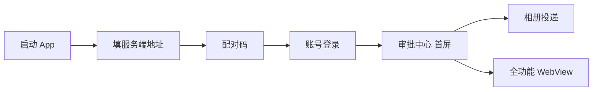

# harness_mobile 开发环境搭建指南

> 适用场景：**Windows 本机开发 + Android 自用测试（不上架）**。
> 本文所有路径与版本均来自**本机实测**（2026-11），可直接照抄；若你的安装位置不同，替换路径即可。
> 姊妹文档：`docs/Android自用运行指南.md`（运行期使用与排障）、`../harness_go/docs/移动端开发实施计划.md`（开发排期）。

---

## 0. 环境速查表（本机实测值）

| 组件 | 版本 | 安装路径 |
| --- | --- | --- |
| Flutter SDK | **3.24.5 stable** | `D:\Software\flutter` |
| Dart | 3.5.4（随 Flutter） | `D:\Software\flutter\bin\dart.exe` |
| JDK | **Temurin 17.0.20.1+1** | `D:\Software\Java\jdk-17.0.20.1+1` |
| Android SDK | platform 34 / build-tools 34.0.0 | `D:\Software\Android\sdk` |
| cmdline-tools | latest | `D:\Software\Android\sdk\cmdline-tools\latest` |
| Android Emulator | 37.2.13 | `D:\Software\Android\sdk\emulator` |
| 系统镜像 | android-34 google_apis x86_64 | `D:\Software\Android\sdk\system-images\android-34\google_apis\x86_64` |
| 已建 AVD | `harness_test` | `%USERPROFILE%\.android\avd\harness_test.avd` |
| 移动端工程 | — | `D:\WorkSpace\Project\harness_mobile` |

> ⚠️ **本机 Flutter 未加入 PATH**：所有命令需用绝对路径 `D:\Software\flutter\bin\flutter.bat`。
> 若想简化，可把 `D:\Software\flutter\bin` 与 `D:\Software\Android\sdk\platform-tools` 加入系统 PATH，之后可直接用 `flutter` / `adb`。

---

## 1. 安装 Flutter SDK

### 1.1 下载

从官方归档页下载 stable 版本的 Windows 压缩包：
`https://docs.flutter.dev/release/archive?tab=windows`

选 **3.24.x stable**（本项目基线为 3.24.5）。**不要用 `git clone`**——仓库体积大且切分支易出问题。

### 1.2 解压到固定路径

```powershell
# 目标：D:\Software\flutter\bin\flutter.bat 存在
# 注意：路径不要含中文和空格，否则 Gradle 可能报错
```

### 1.3 验证

```powershell
D:\Software\flutter\bin\flutter.bat --version
```

期望输出：

```
Flutter 3.24.5 • channel stable • https://github.com/flutter/flutter.git
Framework • revision dec2ee5c1f (2 years ago) • 2024-11-13 11:13:06 -0800
Tools • Dart 3.5.4 • DevTools 2.37.3
```

### 1.4 加入 PATH（可选但强烈建议）

```powershell
# 以管理员身份运行
[Environment]::SetEnvironmentVariable(
  "Path",
  [Environment]::GetEnvironmentVariable("Path", "Machine") + ";D:\Software\flutter\bin",
  "Machine"
)
```

**改完必须重开终端**才生效。若不想重启，本文所有命令都用绝对路径即可。

---

## 2. 安装 JDK 17

Android Gradle 构建需要 JDK 17（不是 8、也不是 21）。

### 2.1 下载安装

推荐 Eclipse Temurin 17（免安装 zip 或 msi 均可）：
`https://adoptium.net/temurin/releases/?version=17`

本机路径：`D:\Software\Java\jdk-17.0.20.1+1`

### 2.2 设置 JAVA_HOME

```powershell
# 临时（当前窗口有效，跑 sdkmanager 等命令时够用）
$env:JAVA_HOME = "D:\Software\Java\jdk-17.0.20.1+1"

# 永久（管理员）
[Environment]::SetEnvironmentVariable("JAVA_HOME", "D:\Software\Java\jdk-17.0.20.1+1", "Machine")
```

### 2.3 验证

```powershell
D:\Software\Java\jdk-17.0.20.1+1\bin\java.exe -version
```

期望：`openjdk version "17.0.20.1" ... Temurin-17.0.20.1+1`

> ⚠️ PowerShell 中 `java -version` 输出到 stderr，被当作"错误"显示为红字是正常现象，不是失败。

---

## 3. 安装 Android SDK

### 3.1 获取 cmdline-tools

从 `https://developer.android.com/studio#command-tools` 下载 `commandlinetools-win-*.zip`，解压后**按下面的结构摆放**（这一步最容易错）：

```
D:\Software\Android\sdk\cmdline-tools\latest\bin\sdkmanager.bat
D:\Software\Android\sdk\cmdline-tools\latest\bin\avdmanager.bat
```

> ❌ 常见错误：解压成 `cmdline-tools\cmdline-tools\bin`（多套一层），会导致 `sdkmanager` 找不到 SDK。
> ✅ 正确：`cmdline-tools\latest\bin`，且必须有 `source.properties` 文件在 `latest` 目录下。

### 3.2 配置 SDK 路径

```powershell
$env:ANDROID_HOME = "D:\Software\Android\sdk"
$env:ANDROID_SDK_ROOT = "D:\Software\Android\sdk"
```

永久生效（管理员）：
```powershell
[Environment]::SetEnvironmentVariable("ANDROID_HOME", "D:\Software\Android\sdk", "Machine")
```

> Flutter 也能自动识别：若 `flutter doctor` 找不到 SDK，可用
> `flutter config --android-sdk D:\Software\Android\sdk` 显式指定。

### 3.3 接受许可并安装基础组件

```powershell
$env:JAVA_HOME = "D:\Software\Java\jdk-17.0.20.1+1"
$sdk = "D:\Software\Android\sdk"

# 接受全部许可（必须，否则后续构建失败）
& "$sdk\cmdline-tools\latest\bin\sdkmanager.bat" --licenses

# 安装构建必需组件
& "$sdk\cmdline-tools\latest\bin\sdkmanager.bat" `
  "platform-tools" `
  "platforms;android-34" `
  "build-tools;34.0.0"
```

### 3.4 验证

```powershell
& "$sdk\cmdline-tools\latest\bin\sdkmanager.bat" --list_installed
```

本机实测输出（可作为对照基线）：

```
build-tools;33.0.1                          | 33.0.1  |
build-tools;34.0.0                          | 34.0.0  |
emulator                                    | 37.2.13 |
platform-tools                              | 37.0.1  |
platforms;android-34                        | 3       |
system-images;android-34;google_apis;x86_64 | 14      |
```

### 3.5 flutter doctor 验收

```powershell
D:\Software\flutter\bin\flutter.bat doctor
```

本机实测结果（可作对照）：

```
[!] Flutter (Channel stable, 3.24.5, on Microsoft Windows [版本 10.0.19045.6466], locale zh-CN)
    ! The flutter binary is not on your path.        ← 未加 PATH，不影响使用
[√] Windows Version
[√] Android toolchain - develop for Android devices (Android SDK version 34.0.0)
[√] Chrome - develop for the web
[√] Visual Studio - develop Windows apps
[!] Android Studio (not installed)                  ← 不需要，命令行即可开发
[√] Proxy Configuration
[√] Connected device (3 available)
[√] Network resources
```

> **`Android Studio (not installed)` 不影响开发**。本机全程用命令行 + 编辑器，无需装 Android Studio。

---

## 4. 安装 Android 模拟器

> 这是本项目环境搭建中**最耗时**的一步（约 2GB 下载）。

### 4.1 安装 emulator 组件与系统镜像

```powershell
$env:JAVA_HOME = "D:\Software\Java\jdk-17.0.20.1+1"

D:\Software\Android\sdk\cmdline-tools\latest\bin\sdkmanager.bat `
  "emulator" `
  "system-images;android-34;google_apis;x86_64"
```

中间提示 `Accept? (y/N)` → 输入 `y` 回车。

### 4.2 ⚠️ 关键：下载必须用独立终端窗口

**实测教训**：镜像文件 `x86_64-34_r14.zip` 约 1.5GB，下载耗时 5–15 分钟。

- 若在自动化命令窗口执行（有 2 分钟超时），会在 30%~60% 处被强制中断
- 日志显示：`Warning: Failed to download package!`
- **但支持断点续传**：重新执行会从断点继续，不会白下

**正确做法**：**单独开一个 PowerShell 窗口**，粘贴上面的命令，耐心等进度条走完。

进度参考（实测）：
```
[====     ] 33% Downloading x86_64-34_r14.zip...   ← 约 1.5GB 文件
[=========] 55% Installing Google APIs Intel x86_64 Atom System Image
```

### 4.3 验证安装成功

```powershell
# 应能看到 emulator 与 system-images 两项
D:\Software\Android\sdk\cmdline-tools\latest\bin\sdkmanager.bat --list_installed | Select-String "emulator|system-images"
```

---

## 5. 创建与启动 AVD（虚拟设备）

### 5.1 创建 AVD

```powershell
$sdk = "D:\Software\Android\sdk"

& "$sdk\cmdline-tools\latest\bin\avdmanager.bat" create avd `
  -n harness_test `
  -k "system-images;android-34;google_apis;x86_64" `
  -d medium_phone
```

参数说明：
- `-n harness_test`：AVD 名称，后续启动用
- `-k`：系统镜像包名，必须与 `--list_installed` 里的一致
- `-d medium_phone`：设备配置。**不要用 `pixel_6`**，本机的设备定义列表里可能不存在；`medium_phone` 一定可用

查看可用设备定义：
```powershell
& "$sdk\cmdline-tools\latest\bin\avdmanager.bat" list device
# 实测可用：automotive_1024p_landscape / Galaxy Nexus / desktop_large /
#           desktop_medium / medium_phone / medium_tablet / Nexus 10 / Nexus 4 / ...
```

### 5.2 列出已建 AVD

```powershell
& "$sdk\emulator\emulator.exe" -list-avds
# 期望输出：harness_test
```

### 5.3 启动模拟器

```powershell
# 正常启动（有窗口）
& "D:\Software\Android\sdk\emulator\emulator.exe" -avd harness_test
```

**首次启动会很慢（1–3 分钟）**，因为要做冷启动初始化。后续启动会快很多。

### 5.4 常用启动参数

| 参数 | 作用 | 适用场景 |
| --- | --- | --- |
| （无） | 正常带窗口启动 | 日常开发 |
| `-no-snapshot-load` | 冷启动，不加载快照 | 模拟器状态异常时 |
| `-no-window` | 无界面（配合 `flutter run` 用） | CI 或只跑测试 |
| `-gpu swiftshader_indirect` | 软件渲染 | **显卡驱动有问题、窗口黑屏时** |
| `-writable-system` | 系统分区可写 | 需要改系统文件时 |
| `-wipe-data` | 清空用户数据 | 模拟器彻底卡死时 |

### 5.5 等待模拟器就绪

模拟器窗口出现**不等于**就绪。用 adb 确认：

```powershell
& "D:\Software\Android\sdk\platform-tools\adb.exe" devices
```

期望输出：
```
List of devices attached
emulator-5554   device        ← 出现这行才算就绪
```

若显示 `offline`，再等 30 秒；若一直无输出，见 §7 排障。

### 5.6 Flutter 识别验证

```powershell
D:\Software\flutter\bin\flutter.bat devices
```

期望在列表中看到：
```
emulator-5554 • sdk gphone64 x86 64 • android-x64 • Android 14 (API 34)
```

---

## 6. 运行 App 并联调

### 6.1 启动服务端（先决条件）

本项目服务端在 `D:\WorkSpace\Project\harness_go`，启动后默认监听本机。

**确认监听状态**：
```powershell
netstat -ano | Select-String ":5611"
```

实测输出（服务端监听 `127.0.0.1:5611`）：
```
TCP    127.0.0.1:5611    0.0.0.0:0    LISTENING    39992
```

> ✅ **监听 `127.0.0.1` 对模拟器是可用的**，因为模拟器通过 `10.0.2.2` 映射到宿主机回环。
> ⚠️ 但**真机 WiFi 直连不行**（手机不在宿主机的回环网段），真机需用 `adb reverse`。

### 6.2 在模拟器运行 App

```powershell
cd D:\WorkSpace\Project\harness_mobile

# 若只连了一个 Android 设备，直接跑
D:\Software\flutter\bin\flutter.bat run

# 若有多个设备，显式指定
D:\Software\flutter\bin\flutter.bat run -d emulator-5554
```

首次运行会做 Gradle 构建，**约 3–10 分钟**（要下载依赖）。之后增量构建很快。

### 6.3 App 内服务端地址怎么填（关键）

| 运行环境 | 服务端地址填 | 原理 |
| --- | --- | --- |
| **Android 模拟器** | `http://10.0.2.2:5611` | `10.0.2.2` 是模拟器访问**宿主机**的专用别名 |
| 真机 + USB | `http://localhost:5611` | 需先 `adb reverse tcp:5611 tcp:5611` |
| 真机 + 同一 WiFi | `http://<电脑局域网IP>:5611` | 需服务端监听 `0.0.0.0` 且防火墙放行 |
| 手机自己跑服务端 | `http://127.0.0.1:5611` | 服务端在手机上 |

> ❌ **最常见错误**：模拟器里填 `localhost` 或 `127.0.0.1`。
> 这两者在模拟器里指**模拟器自己**，不是你的电脑，必然连不上。

### 6.4 首次使用流程



1. **服务端地址**：模拟器填 `http://10.0.2.2:5611`
2. **配对码**：在服务端 Web 端生成（`POST /api/v1/devices/pair-codes`，`kind=mobile`）
3. **登录**：输入服务端配置的账号
4. **审批中心**：之后启动直接到这里，重启免配对免登录

### 6.5 日常开发命令

```powershell
# 热重载：运行中按 r（在 flutter run 的终端里）
# 热重启：按 R

# 静态检查（零容忍）
D:\Software\flutter\bin\flutter.bat analyze --fatal-infos --fatal-warnings

# 单元测试（当前基线 151 个）
D:\Software\flutter\bin\flutter.bat test

# 构建 APK
D:\Software\flutter\bin\flutter.bat build apk --release
# 产物：build\app\outputs\flutter-apk\app-release.apk
```

---

## 7. 常见问题排障

### 7.1 模拟器相关

| 现象 | 原因 | 解决 |
| --- | --- | --- |
| `Unable to find any emulator sources` | emulator 组件未装 | 执行 §4.1 |
| `flutter emulators` 返回空但 AVD 已建 | Flutter 未识别 SDK 路径 | `flutter config --android-sdk D:\Software\Android\sdk` |
| 启动后 `adb devices` 一直空 | 模拟器还在冷启动 | 等 1–3 分钟；仍无则看 §7.2 |
| 模拟器窗口全黑 | GPU 渲染问题 | 加参数 `-gpu swiftshader_indirect` |
| `HAXM` / `Hyper-V` 报错 | 硬件加速未开 | BIOS 开虚拟化（VT-x）；Windows 开启「Hyper-V」或「Windows 虚拟机监控程序平台」 |
| 模拟器卡死 | — | `-wipe-data` 重启，或删除 AVD 重建 |
| 磁盘空间不足 | 镜像约 2GB + AVD 约 4GB | 清理磁盘，至少留 10GB |

### 7.2 网络连接相关

| 现象 | 原因 | 解决 |
| --- | --- | --- |
| App 报 `无法连接服务端，请确认地址与网络` | 地址填错 | 模拟器必须填 `10.0.2.2`，不是 `localhost` |
| 报 `CLEARTEXT communication not permitted` | Android 9+ 拦截明文 HTTP | 项目已配 `network_security_config.xml`；若仍报错，确认 `AndroidManifest.xml` 已挂载 `android:networkSecurityConfig` |
| 真机 WiFi 连不上 | 服务端只监听 `127.0.0.1` / 防火墙 | 改用 `adb reverse`；或服务端改监听 `0.0.0.0` |
| `adb reverse` 后仍连不上 | 命令未执行或端口不符 | 重新执行 `adb reverse tcp:5611 tcp:5611`，端口要与服务端一致 |

### 7.3 构建相关

| 现象 | 原因 | 解决 |
| --- | --- | --- |
| `Could not determine java version` | JAVA_HOME 未设或版本不对 | 设为 JDK 17（§2.2） |
| `SDK location not found` | 未设 ANDROID_HOME | 设 `ANDROID_HOME=D:\Software\Android\sdk`，或在 `android/local.properties` 写 `sdk.dir` |
| Gradle 下载慢/超时 | 网络 | 首次构建需下载 Gradle 与依赖，耐心等；可配国内镜像 |
| `Failed to install the app` | 签名冲突（曾装过不同签名的包） | 先卸载旧版：`adb uninstall com.harness.harness_mobile` |

### 7.4 PowerShell 特有陷阱（本项目实测）

| 陷阱 | 说明 | 应对 |
| --- | --- | --- |
| **退出码失真** | `flutter.bat ... \| Select-Object` 会返回 1（即使成功） | 重定向到日志文件再读：`flutter.bat analyze > a.log 2>&1; Get-Content a.log` |
| `java -version` 显示红字 | 输出到 stderr，PowerShell 视为错误流 | 正常现象，不影响 |
| `2>&1` 后中文乱码 | 编码问题 | 用 `-Raw` 读或设 `$OutputEncoding = [Console]::OutputEncoding = [Text.Encoding]::UTF8` |
| 路径含空格需引号 | — | 所有 `& "路径"` 形式 |

---

## 8. 环境验收清单

全部通过即可开始开发：

```powershell
# 1. Flutter 可用
D:\Software\flutter\bin\flutter.bat --version

# 2. Android 工具链就绪
D:\Software\flutter\bin\flutter.bat doctor
#    期望：[√] Android toolchain

# 3. 模拟器组件已装
D:\Software\Android\sdk\cmdline-tools\latest\bin\sdkmanager.bat --list_installed | Select-String "emulator|system-images"

# 4. AVD 已建
D:\Software\Android\sdk\emulator\emulator.exe -list-avds
#    期望：harness_test

# 5. 模拟器可被识别（需先启动模拟器）
D:\Software\flutter\bin\flutter.bat devices
#    期望：出现 emulator-5554

# 6. 工程可编译可测试
cd D:\WorkSpace\Project\harness_mobile
D:\Software\flutter\bin\flutter.bat analyze --fatal-infos --fatal-warnings   # No issues found!
D:\Software\flutter\bin\flutter.bat test                                    # 151 passed
```

---

## 9. 一键启动脚本（可选）

把下面内容存成 `D:\WorkSpace\Project\start-dev.ps1`，日常双击运行即可：

```powershell
# start-dev.ps1 — 启动模拟器 + 服务端提示
$sdk = "D:\Software\Android\sdk"
$flutter = "D:\Software\flutter\bin\flutter.bat"

Write-Host "=== 1/3 启动 Android 模拟器 ===" -ForegroundColor Cyan
Start-Process -FilePath "$sdk\emulator\emulator.exe" -ArgumentList "-avd harness_test"
Write-Host "等待模拟器就绪（约 60 秒）..."
Start-Sleep -Seconds 60

Write-Host "=== 2/3 检查设备 ===" -ForegroundColor Cyan
& "$sdk\platform-tools\adb.exe" devices

Write-Host "=== 3/3 提示 ===" -ForegroundColor Cyan
Write-Host "请另开终端启动服务端（harness_go），然后执行：" -ForegroundColor Yellow
Write-Host "  cd D:\WorkSpace\Project\harness_mobile"
Write-Host "  $flutter run"
Write-Host ""
Write-Host "App 内服务端地址填：http://10.0.2.2:5611" -ForegroundColor Green
```

---

## 10. 与「上架发布」的差异

本环境面向**自用开发**。若将来要上架，还需补充：

- 正式 keystore 与 `signingConfig` 配置
- `network_security_config.xml` 的 `base-config` 收紧为 `false`（仅白名单自己的地址）
- iOS 侧：Xcode + 开发者账号 + Privacy Manifest 维护
- 隐私合规弹窗、分渠道打包、商店材料

详见 `docs/移动端开发实施计划.md` §6。

---

## 11. 版本变更记录

| 日期 | 变更 |
| --- | --- |
| 2026-11 | 首版。基于本机实测：Flutter 3.24.5 / JDK 17.0.20.1 / Android SDK 34 / Emulator 37.2.13 / AVD `harness_test`。记录模拟器镜像下载的断点续传与独立窗口要求。 |
